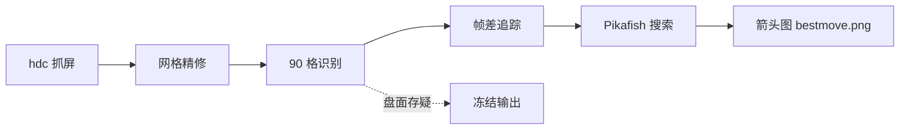

# 象棋视觉助手 · xiangqi-vision-assistant

用摄像头「看」手机上的 JJ 象棋：自动识别棋盘、追踪每一步走子，再用 Pikafish 引擎算出最佳应手，最后在截图上画出箭头。

> 适用场景：手机端人机/真人对局时，把手机用 USB 连上电脑，程序实时抓屏分析。



## 特性

- **自动定向**：识别帅/将位置判断红方在屏幕上方还是下方，不依赖固定摆法
- **走子追踪**：帧差对比找出变化格，反推「谁从哪走到哪」，同一帧内双方各走一步也能拆解
- **兑子与复用**：允许落点被复用、来源格全排列求解，吃子场景不会卡住
- **中文记谱**：输出「炮八平五」这样的标准记法，同时给出 UCI 着法与评估分
- **不轻易开口**：盘面存疑时宁可不出建议，也不给错误建议（见下方「识别守门」）

## 环境要求

| 依赖 | 说明 |
|---|---|
| Windows + Python 3.10+ | 开发与实测环境 |
| 鸿蒙手机 | 开启「开发者模式 → USB 调试」，安装 JJ 象棋 |
| hdc | DevEco Studio 自带，路径写进 `config.json` |
| Pikafish | 引擎本体 + nnue 权重（本仓库不附带，见下方获取） |

## 获取引擎

仓库不包含 `engine/pikafish.exe` 与 `pikafish.nnue`（体积原因）。自行下载后放到：

```
engine/pikafish.exe     # 引擎可执行文件
pikafish.nnue           # 权重文件，与 exe 同目录层级
```

Pikafish 发布页下载对应平台包即可，权重放项目根目录、文件名保持 `pikafish.nnue`。

## 快速开始

```bash
# 1. 安装依赖
pip install -r requirements.txt
pip install -e .            # 可选：装成包后任意目录都能 `python -m xiangqi.main`

# 2. 准备一张「初始局面」的手机截图（棋盘摆好、轮到红方）
#    然后交互式标定棋盘四角，会自动生成 config.json 与 14 张棋子模板
python -m xiangqi.calibrate_cli shot.png

# 3. 开始监控（每轮抓屏 → 识别 → 算棋 → 写 bestmove.png）
python -m xiangqi.main --debug
```

运行时把 `bestmove.png` 开在图片查看器里（支持自动刷新更好），走一步就能看到新箭头。

常用参数：

```bash
python -m xiangqi.main --movetime 8000     # 引擎思考 8 秒（默认 5000）
python -m xiangqi.main --interval 0.3      # 轮询间隔
python -m xiangqi.main --show              # 开实时窗口（tkinter）
python -m xiangqi.main --debug             # 打印每帧追踪细节
```

## 配置说明

`config.json` 由标定工具生成，也可照 `config.example.json` 手写。

| 字段 | 说明 |
|---|---|
| `hdc_path` | hdc.exe 绝对路径 |
| `player_side` | 我方阵营，`bottom` / `top` |
| `board_corners` | 棋盘四角坐标（标定时的截图尺寸下） |
| `screen_size` | 标定截图的分辨率，抓图尺寸变了会按比例换算四角 |
| `capture_scale` | 抓图缩放比例，0.35 时 440×966，够识别且快 |
| `templates_dir` | 棋子模板目录 |
| `engine_path` | 引擎路径，支持相对项目根目录 |
| `movetime_ms` | 每步思考毫秒数 |
| `engine_threads` / `engine_hash_mb` | 引擎线程数与置换表大小 |
| `flip_board` | 强制翻转棋盘（自动定向失灵时兜底） |
| `remote_path` / `local_path` | 设备端与本地截图路径 |

## 目录结构

```
xiangqi-vision-assistant/
├── xiangqi/                 核心包
│   ├── main.py              主循环：抓屏 → 识别 → 追踪 → 算棋 → 画箭头
│   ├── capture.py           hdc 抓屏、设备连接检查
│   ├── calibrate.py         透视矫正、网格精修、模板加载
│   ├── calibrate_cli.py     标定助手（点四角 → 生成 config + 模板）
│   ├── recognize.py         90 格识别、数量纠错
│   ├── occupancy.py         占空图（按格中心亮度判有子/无子）
│   ├── tracking.py          帧差追踪走子、失联重同步
│   ├── moves.py             走法合法性判断
│   ├── notation.py          UCI 坐标 ↔ 中文记谱
│   ├── engine.py            Pikafish 进程封装
│   ├── display.py           走法箭头、暂停提示卡
│   ├── board.py             棋盘表示、FEN、子力校验
│   ├── turn_detect.py       计时器区域差分判先后
│   ├── diagnose.py          单帧诊断（打印每格匹配分）
│   └── retemplate.py        只重新生成模板
├── tests/                   130 项测试（含合成棋局渲染）
├── templates/               14 张棋子模板（标定产物，不入库）
├── engine/                  Pikafish 本体（不入库）
├── docs/                    设计说明与实施计划
├── config.example.json      配置模板
└── requirements.txt
```

## 测试

```bash
python -m pytest -q
```

覆盖：棋盘/FEN、走法规则、识别（含落点光点幻觉、网格偏移）、追踪（双步、兑子、假解排除）、
显示（箭头头部尺寸、提示卡），以及端到端主循环（用合成棋盘渲染模拟真实对局）。

## 识别守门

真机上最大的敌人不是算力，而是**识别漂移**——一旦盘面读错，引擎会在错误的棋盘上给出看起来很美的着法。
所以主循环里设了四道闸：

| 闸 | 触发 | 行为 |
|---|---|---|
| 合法性清理 | 士/象/帅落在规则外，或某类棋子超数量 | 按置信度清掉多余格 |
| 子力校验 | 一步之内少两个以上，或凭空多子 | 拒绝采纳，保留原盘面 |
| 独立复核 | 出建议前重新识别整盘，与追踪盘面不一致 | 冻结输出 |
| 可信度守门 | 重同步、FEN 非法、盘面不自洽 | 暂停 **3 帧**（约 6 秒）后自动恢复 |

冻结时不会删 `bestmove.png`（预览面板会显示「暂无数据」），而是覆盖一张提示卡：
整体压暗 + 居中「暂不给出建议 / 画面稳定后自动恢复」。

## 已知限制

- 仅适配 JJ 象棋竖屏布局（棋盘比例、九宫位置、计时器区域都是按实机标定的）
- 抓屏耗时约 1.5~3 秒，瓶颈在设备端 PNG 编码；把 `capture_scale` 调小可提速
- 走子动画未结束时画面会短暂判为不稳定，此时不出建议属正常
- 换了手机主题或分辨率需要重新跑一次 `calibrate_cli`
- 棋子模板与屏幕主题相关，仓库不附带，需自行标定
